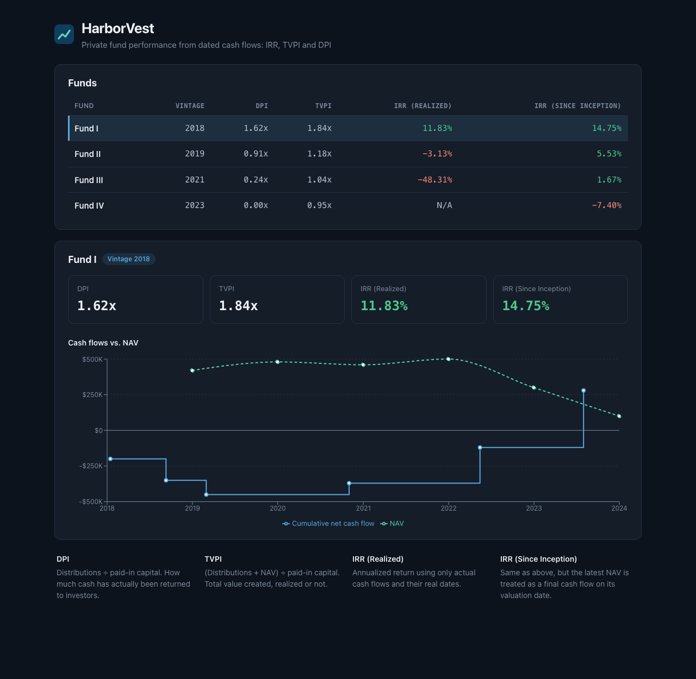

# HarborVest: Fund Performance Dashboard

A full-stack app for tracking private equity / VC fund cash flows and computing standard performance metrics (IRR, TVPI and DPI) from contribution, distribution and NAV data.



## Why

Fund performance is usually reported through opaque spreadsheets. This project models the underlying cash-flow math directly and exposes it through a REST API and a dashboard. IRR is computed XIRR-style: a custom XNPV function over the actual cash flow dates (not evenly spaced periods), solved with SciPy's Brent root finder and checked against `pyxirr` in the tests.

## Features

- **Fund table:** DPI, TVPI, realized IRR and since-inception IRR for every fund
- **Fund detail:** metric cards plus a chart of cumulative net cash flow against NAV over time (the classic PE "J-curve")
- **Two IRRs:** realized-only IRR, and since-inception IRR that treats the latest NAV as a terminal cash flow
- **Safe fallbacks:** if a NAV is missing or older than the last cash flow, since-inception IRR falls back to realized IRR instead of double-counting value or crashing the API
- **REST API:** `GET /funds`, `GET /funds/{id}`, `POST /funds/{id}/cashflows` with validation (interactive docs at `/docs`)

## Tech Stack

- **Backend:** FastAPI, SQLAlchemy 2.0, Pydantic, SciPy, SQLite
- **Frontend:** React, Vite, Recharts
- **Testing / Infra:** pytest, Docker Compose (nginx-served frontend), GitHub Actions CI

## Metrics

- **IRR:** annualized internal rate of return, computed from actual cash flow dates
- **TVPI:** Total Value to Paid-In, `(distributions + NAV) / contributions`
- **DPI:** Distributions to Paid-In, `distributions / contributions`

## Project Structure

```
backend/
  app/
    metrics.py        pure math: DPI, TVPI, IRR, IRR with NAV
    fund_service.py   turns ORM rows into metrics
    models.py         Fund, CashFlowEvent, NavSnapshot
    routers/funds.py  API routes
  tests/              metric unit tests + API tests
frontend/
  src/
    components/       FundTable, CashFlowChart
```

## Running Locally

**With Docker (easiest)**

```bash
docker compose up --build
docker compose run --rm backend python -m app.seed_data   # first run only
```

Open http://localhost:5173. API docs are at http://localhost:8000/docs.

**Backend**

```bash
cd backend
python -m venv venv
source venv/bin/activate
pip install -r requirements.txt
python -m app.seed_data   # first run only
uvicorn app.main:app --reload
```

**Frontend**

```bash
cd frontend
npm install
npm run dev
```

**Tests**

```bash
cd backend
source venv/bin/activate
pip install -r requirements-dev.txt
python -m pytest
```

## Dev Log

[DEVLOG.md](DEVLOG.md) records the design decisions and bugs found along the way, including why realized IRR and TVPI can disagree, a stale-NAV double-counting bug, and a Decimal serialization issue that showed up as `0E+2` in the UI.

## Built With AI Assistance

I wrote the backend, metrics engine, tests, Docker setup and CI, plus the original React frontend. Throughout the build I used [Claude](https://claude.ai) (Anthropic) as a tutor and code reviewer: I asked it to review my code, explain concepts and point out bugs, then wrote the fixes myself. The final UI polish (styling, metric cards, the cash flow vs. NAV chart) and the README rewrite were done with Claude Code. The design decisions and debugging in [DEVLOG.md](DEVLOG.md) are my own.

## Roadmap

- [ ] Add tests for `fund_service.compute_fund_metrics`
- [ ] Use `selectinload` in `get_funds` to avoid N+1 queries as the number of funds grows
- [ ] Refactor the three repeated fetch functions in `api.js` into one shared `request()` helper
- [ ] Make `test_irr_with_nav` check against `xirr()` instead of only `>` comparisons
- [ ] Form in the UI for adding cash flows (the API endpoint already exists)
- [ ] Deploy a live demo
